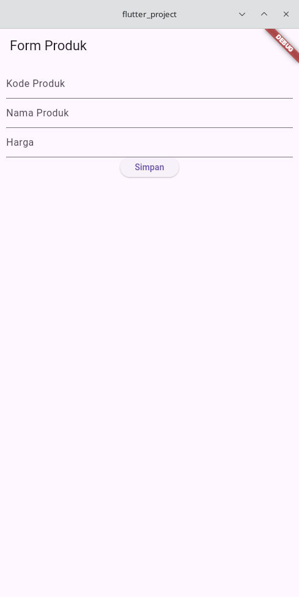
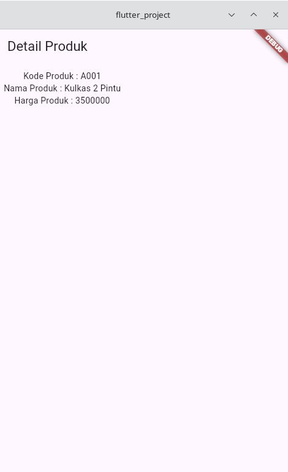
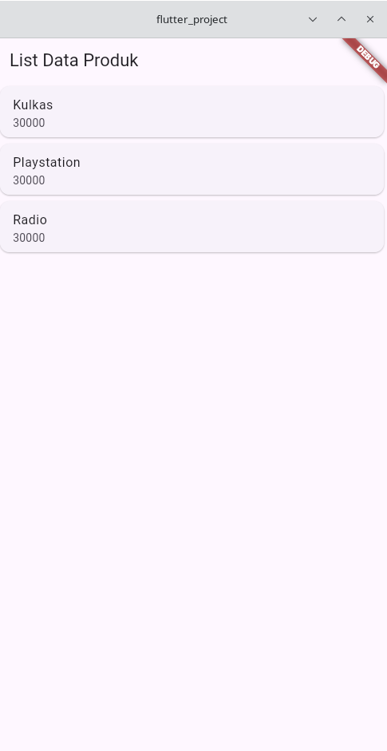
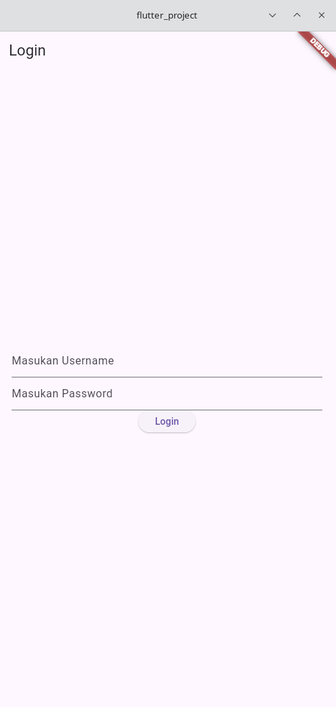
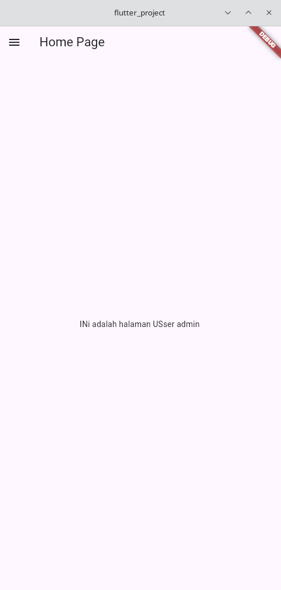
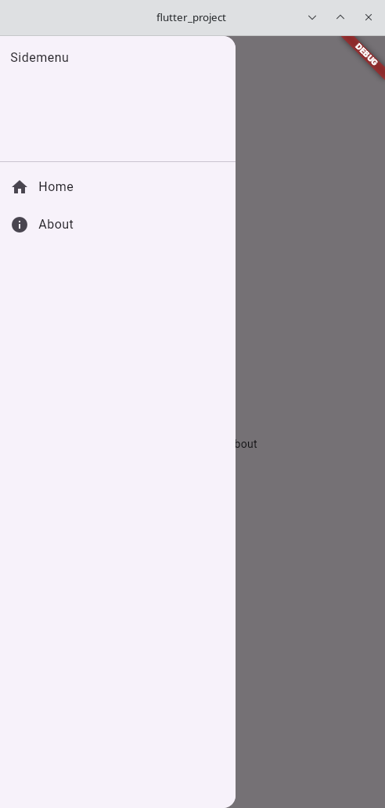
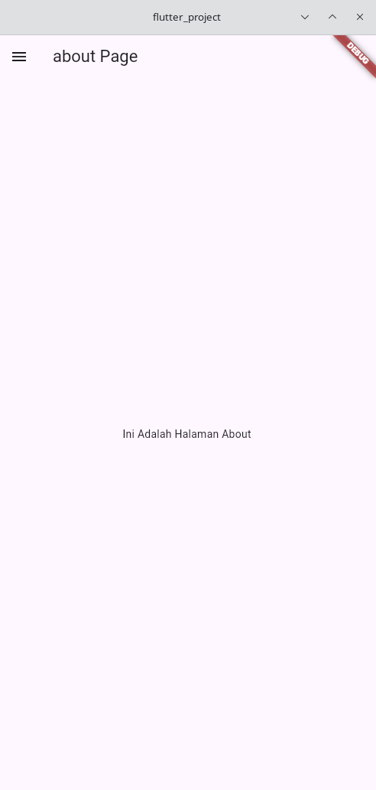

# Laporan Praktikum Pemrograman Mobile

| | |
|---|---|
| **Nama** | Fariz Rahman Syahida |
| **NIM** | H1D024008 |
| **Shift** | Awal F / Akhir C |
| **Praktikum** | Pemrograman Mobile |

**Daftar Isi:** [Pertemuan 2](#pertemuan-2) | [Pertemuan 3](#pertemuan-3)

---

## Pertemuan 2
**Tanggal**: Selasa, 8 September 2026  
**Topik:** Pengenalan Framework Flutter, Dart, Widget, & Layout UI

**Yang Dikerjakan:**
- **Form Produk (`produk_form.dart`)**: Membuat formulir input menggunakan `StatefulWidget` dengan `TextEditingController` untuk menangkap data Kode Produk, Nama Produk, dan Harga Produk, serta mengimplementasikan navigasi `Navigator.push` saat tombol Simpan ditekan.
- **Detail Produk (`produk_detail.dart`)**: Membuat tampilan penampung data menggunakan `StatelessWidget` untuk menampilkan parameter hasil lemparan/parsing data dari form produk secara dinamis.
- **List Data Produk (`produk_page.dart`)**: Membuat tampilan daftar produk menggunakan `ListView`, `Card`, dan `ListTile` untuk menampilkan sekumpulan item/data secara terstruktur.

**Kesimpulan:**
Pertemuan kedua memberikan pemahaman mendasar mengenai kerangka kerja Flutter dan bahasa pemrograman Dart. Saya mempelajari perbedaan antara `StatelessWidget` dan `StatefulWidget`, pengelolaan struktur tata letak (layout) UI dengan widget dasar (`Column`, `Row`, `Container`, `ListView`), serta mekanismenya dalam melakukan navigasi antar-layar dan *data passing* antar-widget.

---

## Pertemuan 3
**Tanggal**: Selasa, 15 September 2026  
**Topik:** Routes, Side Menu, Login, dan Local Storage

**Yang Dikerjakan:**
- **Halaman Login (`login_page.dart`)**: Membuat form login menggunakan `StatefulWidget` dengan `TextEditingController` untuk username dan password, menampilkan `AlertDialog` hasil login, serta menyimpan username ke local storage menggunakan package `shared_preferences` sebelum berpindah ke halaman Home dengan `Navigator.push`.
- **Halaman Home (`home_page.dart`)**: Membuat tampilan menggunakan `StatefulWidget` yang mengambil username dari local storage lewat `SharedPreferences` untuk ditampilkan pada halaman secara dinamis.
- **Side Menu (`sidemenu.dart`)**: Membuat menu samping menggunakan `Drawer`, `DrawerHeader`, dan `ListTile` yang berisi route ke halaman Home dan About dengan `Navigator.push` dan `MaterialPageRoute`.
- **Halaman About (`about_page.dart`)**: Membuat halaman tambahan menggunakan `StatelessWidget` dengan `Scaffold`, `AppBar`, dan teks di tengah layar, serta memasang `Sidemenu` pada properti `drawer` agar menu tetap dapat diakses dari halaman ini.

**Kesimpulan:**
Pertemuan ketiga memberikan pemahaman mengenai pembuatan sistem login sederhana, navigasi antar-halaman menggunakan route, dan pembuatan side menu dengan widget `Drawer`. Saya juga mempelajari penggunaan local storage melalui `shared_preferences` untuk menyimpan dan mengambil data username sehingga dapat ditampilkan di halaman lain.
